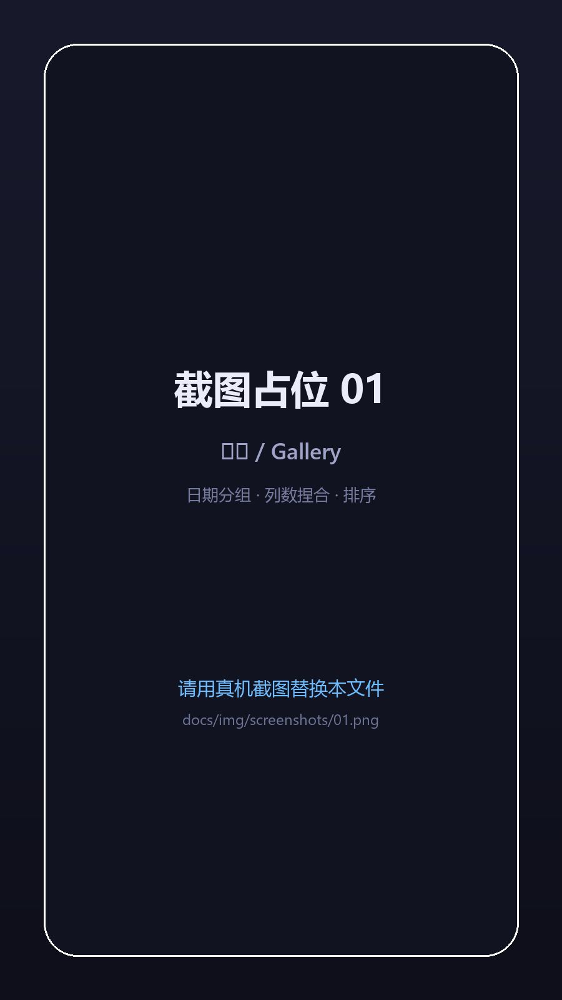
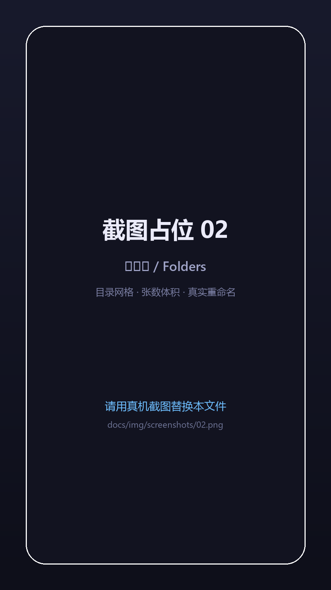
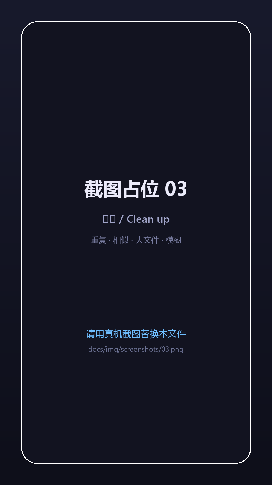
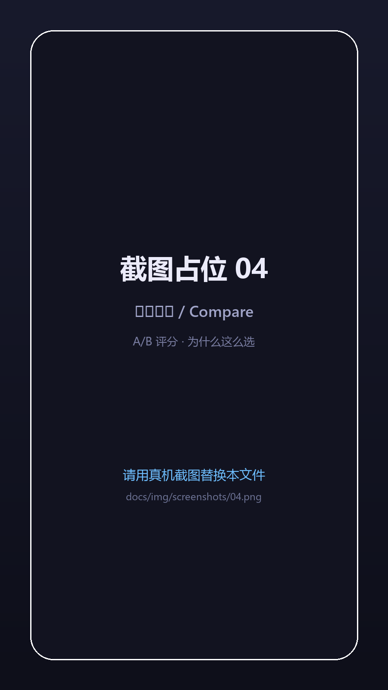
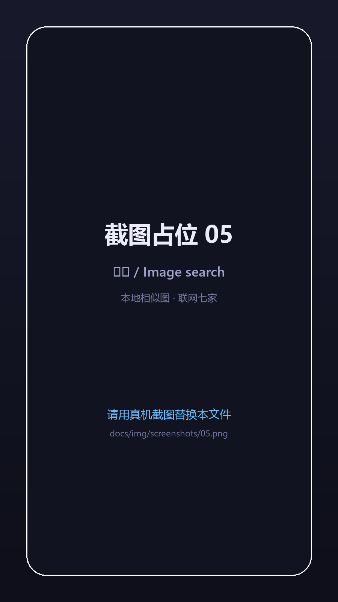

<div align="center">


# Eropic

**A local-first photo & storage manager for Android 12+**

120 GB of photos on your phone, and the stock gallery can't show them all, can't manage them, can't clean them up. Eropic does exactly three things: **see everything, find the right ones, and touch real files**.

[-3DDC84?logo=android&logoColor=white)](https://developer.android.com)
[](https://kotlinlang.org)
[](https://developer.android.com/jetpack/compose)
[](https://github.com/33kurumi/Eropic/releases)
[](LICENSE)

[简体中文](README.md) · **English**

</div>

---

## Why Eropic exists

Storage full alert, and `Pictures` alone is 120 GB. Cleaning it up turned out to be painful:

- **The stock gallery doesn't show everything** — it only surfaces folders the media database indexed; deep folders and scattered screenshots are simply invisible.
- **Third-party cleaners were a no-go** — cloud sync, accounts, or an "AI cleanup" that deletes on your behalf.
- **What I actually wanted was the truth** — which photos are duplicates, which screenshots are blurry, which folder eats the most space. Show me the data, **I decide what gets deleted**.

So Eropic stays deliberately restrained: **it only indexes, compares and presents — the delete decision is always yours**. But when it does act, it acts on **real storage**: real moves, real renames, real trash folder — not just rows in a private database.

## Features

### 1. See everything

- **Own index** — MediaStore stays the source of truth, Room is a rebuildable cache; incremental sync plus periodic reconciliation, so 100k-photo libraries stay usable.
- **Folders are albums** — browse the real directory tree; each folder shows **photo count and total size** (toggleable); on any mid-level folder, one switch merges **all subfolders** into that view.
- **Folder grid mode** — cover cards with count/size, drill down by tapping; pin to top, change cover, **rename the real directory**, move a whole folder to trash.
- **Sort & zoom** — sort by date / name / size / resolution / format; **pinch to change grid columns** (2–8); collapsible date headers with expand-all / collapse-all.
- **Viewer** — pinch zoom, double-tap, swipe paging, slideshow, set as wallpaper, open with another app, original EXIF (camera, lens, aperture, shutter, ISO, GPS).
- **Search** — space = all terms, quotes = exact phrase, leading minus = exclude (`cat -screenshot`), with search history and saved filters.

### 2. Find the right ones

- **Exact duplicates** — identical file content (SHA-256), even when names differ.
- **Similar photos** — perceptual hashing (dHash + pHash), bucketed inverted-index candidates, then colour-layout/histogram-weighted re-ranking; strict / normal / loose thresholds.
- **Eight candidate categories** — duplicates, similar, large files, old photos, screenshots, blurry shots, burst shots, high-resolution images.
- **Quality scoring** — each image scored on pixels / format / bits-per-pixel / capture time / filename / sharpness, **with a suggested keeper**, and the reasoning written on every card.
- **Compare preview** — swipe through the group, compare parameters, similarity and score basis; "keep this group" marks it so a rescan stops nagging.
- **Combined filters** — size, resolution, format, date, folder; saveable.

> ⚠️ **Eropic never deletes automatically.** No "one-tap smart cleanup", no background deletions — selections only build a candidate list, execution is your call.

### 3. Act on real files

- **Real move / copy / rename** — operates on real paths (`rename` within a volume, copy+delete across volumes), then notifies the media store so the stock gallery updates immediately.
- **Batch rename** — templates `{date}_{n}`, `{name}`, `{ext}`, `{time}`; conflicts highlighted in the preview.
- **Trash** — deletions go to `<volume root>/.EropicTrash` (30 days by default; 7 / 60 / forever available), with one-tap restore, permanent delete and a 5-second undo. Location is visible and configurable.
- **Controllable batches** — progress bar with pause / resume / cancel, a result report (successes, failure reasons, bytes), and **per-item undo in the operation history**.
- **Storage insights** — empty-folder scan and cleanup, storage overview by format / year / folder.

### 4. Image search

- **Local similar-image search** — pick one image, find the closest matches by perceptual-hash distance (colour re-ranking, keyword filter); "find same character" votes on metadata tags.
- **Reverse image search online** — Google Lens / Baidu / SauceNAO / ascii2d / IQDB / onegai.moe / Lenso.ai. **Nothing is uploaded until you tap**, and only the single image you picked.

## Screenshots

<div align="center">
  
  
</div>

> Placeholders for now (`docs/img/screenshots/01.png` … `06.png`). Drop real device screenshots over the same filenames — no README edit needed.

## Download & install

Grab `Eropic-release-<version>-<buildtime>.apk` from [Releases](https://github.com/33kurumi/Eropic/releases).

```bash
adb install -r Eropic-release-*.apk
```

**Two permissions on first run** (the app walks you through both):

1. **Photos and videos** → allow everything. Granting only "selected photos" makes the gallery look incomplete; the app warns you in-app.
2. **All files access** → only needed for write operations (real moves, renames, trash).

> Recommended first run: grant permissions → tap "Start indexing" in the gallery → open Clean up, review duplicate/similar groups → select → move to trash → permanently delete once you are sure.
>
> Upgrading from an early **debug-signed** build requires **uninstalling first** (`adb uninstall io.github.kurumi33.eropic`). Uninstalling clears the app's index and settings; **your photos and the trash folder are untouched**.

## Build from source

```bash
git clone https://github.com/33kurumi/Eropic.git
cd Eropic

./gradlew.bat :app:assembleRelease      # output in app/build/outputs/apk/release/
```

Requirements: JDK 17, Android SDK (compileSdk 36 / build-tools 36), Gradle 8.13 (wrapper included).

Signing: the repo ships `keystore/eropic-release.jks` (alias `eropic`, RSA 2048, 30 years) with the password in `keystore.properties` (not committed — supply your own; without it the build falls back to debug signing). Copy both files to keep upgrading over the same signature on another machine.

## Tech stack

| Layer | Choice |
| --- | --- |
| Language / UI | Kotlin 2.0 · Jetpack Compose (Material 3) · custom theme & dynamic colour |
| Data | MediaStore (source of truth) + Room (rebuildable index, DB v7) · Paging 3 · DataStore |
| Imaging | Coil 3 · custom WebP thumb LRU on disk · dHash/pHash/SHA-256 |
| Background | WorkManager (periodic reconciliation, thumb backfill) · MediaStore change observer (1.5 s debounce) |
| DI | Hand-written `AppContainer` (no DI framework) |
| Minimum | Android 12 (API 31), targetSdk 36 |

Architecture in one sentence: **MediaStore is the only source of truth and Room is a cache that can be rebuilt at any time**; writes go "back up to trash first, then update the index", so every step is reversible.

## Privacy

- **Works fully offline** — browsing, duplicate detection, cleanup and file operations are all local.
- **The only network access** — when *you* tap reverse image search: the single image you picked is sent to that service (some need a temporary image host, links expire in an hour).
- **No accounts, no analytics, no tracking, no cloud sync.** Logs stay on device and are only shared if you export them.

## Known limitations

- Search is `LIKE '%kw%'` full-table scan (fine at 100k images, no FTS yet);
- Videos are counted and browsable only — **no video dedupe** yet;
- The trash is Eropic's own `.EropicTrash` folder, **not the system MediaStore trash**;
- Most reverse-image services use unofficial web endpoints and may break when they change;
- The first index of a large library takes a few minutes (interruptible, progress is kept).

## Versions

Semantic-ish `1.1.x` increments; only grouped feature work goes to 1.2. **Release builds only.**
In-app "Settings → About & updates → Check for updates" reads the latest GitHub Release and offers download/install.

## Feedback

- Issues: [github.com/33kurumi/Eropic/issues](https://github.com/33kurumi/Eropic/issues)
- Email: Aemeath33@163.com

## License

[MIT](LICENSE) © 33kurumi

Thanks to the open-source projects that inspired parts of the design: [Aves](https://github.com/deckerst/aves), [Immich](https://github.com/immich-app/immich), [PhotoPrism](https://github.com/photoprism/photoprism), [Fossify Gallery](https://github.com/FossifyOrg/Gallery), [PicImageSearch](https://github.com/kitUIN/PicImageSearch).
