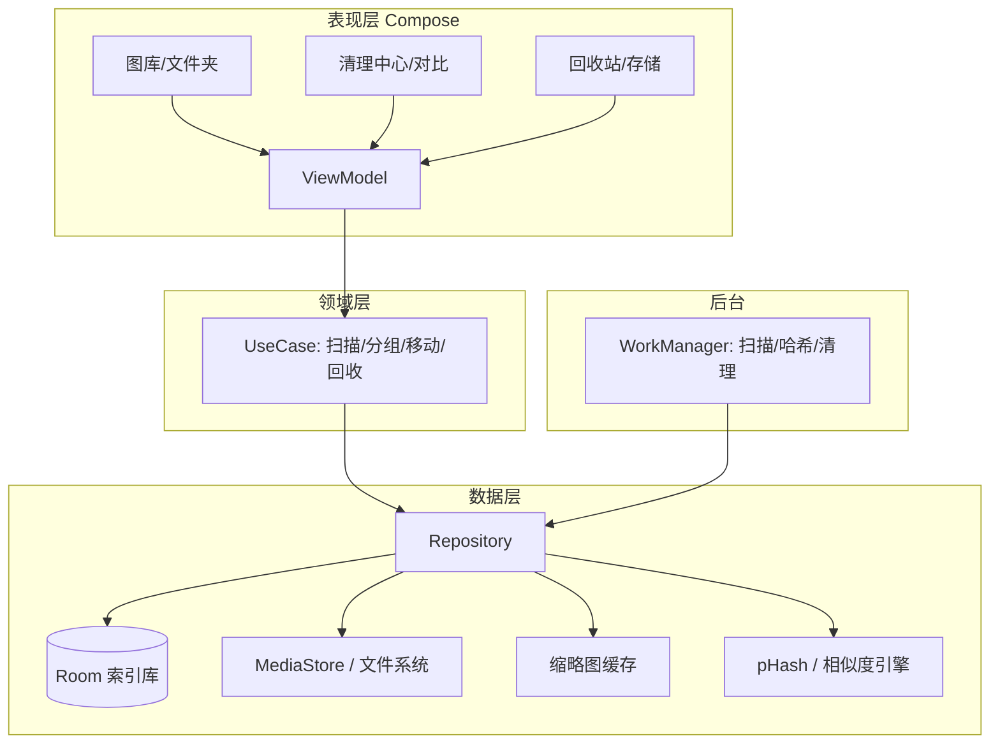

# Eropic 项目规划（v0.1 · 调研整合版）

> 状态：待评审（已整合竞品、相似算法、Android 平台三份调研；2026-10-27 已按你的反馈确认设备、分发方式与 M0 范围） · 日期：2026-10-27 · 目标平台：Android 12+
> 本文档是「产品 + 技术」一体的规划初稿。第 8 章列出待拍板问题，其中已确认项见 8.1；工程与开发侧文档见 `docs/dev/`。

---

## 目录

1. 背景与产品定位
2. 竞品与可借鉴实现
3. 功能规划（P0/P1/P2）
4. 关键交互设计
5. 技术方案
6. 里程碑与排期
7. 风险清单
8. 待决策问题（需要你拍板）
9. 参考资料
10. 附录：任务拆解（WBS）

---

## 1. 背景与产品定位

### 1.1 要解决的问题

你的真实处境：手机里 `Pictures` 等目录累计 **120GB+** 图片，而现有工具都不够用。

| 痛点 | 具体表现 | 现有工具的不足 |
|---|---|---|
| 看不全 | 微信/QQ/下载/截图散落在各种目录，部分目录不被系统媒体库索引（.nomedia、聊天软件目录） | 系统相册只展示被 MediaStore 收录的媒体，漏图且不可控 |
| 管不了 | 文件夹视图不能"聚合子文件夹"、不显示文件数/总大小、不能按分辨率/格式/大小排序 | 系统相册文件夹视图极简；第三方相册大多只做展示 |
| 清不掉 | 重复图（改名的、转发的、连拍的）靠肉眼翻 12 万张不现实 | 清理类 App 广告多、上传云端、误删、不能真实移动 |
| 动不了 | 想把某目录的图归到新目录，需要在文件管理器里手动搬 | 相册 App 的"移动"多数只是改 App 内分类，不动真实文件 |
| 不敢删 | 删错无法恢复 | 多数清理 App 没有回收站，或回收站不可靠 |

### 1.2 一句话定位

> **Eropic 是一个"本地优先"的个人图片资产管理与空间清理工具：看得全、找得准、动得了真实文件、删了能恢复，且所有删除决策都由用户做出。**

它不是"又一个相册"，而是三件事的合体：

1. **相册**：精准、流畅、可按文件夹/时间/条件浏览 10 万+ 张图片；
2. **清理**：用算法把重复/相似/大文件/久远/截图/模糊图片找出来，交给用户对比决策；
3. **文件管理**：移动、重命名、回收站，全部作用于真实存储路径。

### 1.3 目标用户

- **核心用户（你）**：Android 重度拍照/收图用户，图库 50GB~500GB，愿意为"可控、可恢复"花时间整理。
- **扩展用户**：摄影爱好者（RAW/HEIC）、微信/QQ 图片囤积者、经常收到大量图片的运营/设计人员。
- **共同特征**：在意隐私（不愿上传云端）、在意数据安全（怕误删）、对"整理"有强迫症式需求。

### 1.4 设计原则（贯穿所有功能）

1. **用户决策，工具只做检索**：永不自动删除；所有批量操作先预览数量与体积，再确认。
2. **精准优先**：自建索引而不是完全信任系统媒体库；宁可首次扫描慢，也要"不漏图"。漏图比慢更不可接受。
3. **真实文件**：所有操作落到真实路径；App 内不维护"假相册"作为唯一事实来源。
4. **可逆**：删除先入回收站（默认 30 天）；移动/重命名可撤销；批量操作有日志。
5. **大库流畅**：以 10 万~30 万文件为设计目标，索引、分页、缩略图缓存、后台任务缺一不可。
6. **本地优先**：核心功能零网络；不采集、不上传；权限最小化。

### 1.5 非目标（v1 明确不做）

- ❌ 不做云同步/云备份（后续可考虑"导出到电脑/网盘"）
- ❌ 不做图片编辑（裁剪、滤镜、修图、拼图）
- ❌ 不做社交/社区/分享广场
- ❌ 不替代系统相机，也不强求替代系统相册
- ❌ 不做自动清理/自动删除（这是与清理类 App 最大的区别）
- ❌ iOS 版本（待定，见第 8 章）

---

## 2. 竞品与可借鉴实现

### 2.1 竞品速览（逐个体检）

| 产品 | 类型/规模 | 值得借鉴 | 不满足我们的地方 |
|---|---|---|---|
| **Immich**（immich-app/immich，117k★） | 自托管相册服务 | 去重 Utility 逐组处理，可按"文件更大 / EXIF 更多"自动预选；只保留 1 张时自动合并相册、收藏、评分、标签；thumbhash 占位 + WebP 小图 + 1440p 大图三级缩略图；删除即入 trash 可恢复 | 需要服务器常开；10 万张时新时间线每次启动全量重载、缩略图不走本地缓存，出现 5~10 秒空白（issue #24312，反面教材） |
| **PhotoPrism**（photoprism/photoprism，40k★） | 自托管相册 | **搜索 DSL 强**：`label:cat color:green type:live` 支持 AND/OR/NOT、通配符、日期过滤；Stacks 归组（RAW+JPG、原图+编辑版）；批量改相册/标签/时间 | 精确重复只在索引时按 SHA1 跳过，**不做 UI 清理**（issue #1308 仍开放）；重服务端 |
| **Aves Libre**（deckerst/aves，5.4k★） | Android 原生相册（Flutter） | **信息架构最值得抄**：相册/文件夹/标签/地图多入口 + 信息面板 + 标签编辑 + 排序搜索；自建媒体库 DB | 纯只读展示：无去重、无清理、无真实移动、无回收站 |
| **Fossify Gallery**（FossifyOrg/Gallery，3.8k★） | Android 相册（Kotlin/XML） | 文件夹视图 + 多字段排序 + 批量移动/复制/重命名；**回收站实现最完整**：隐藏 `.trash` 目录 + `.nomedia` + 文件名加时间戳 + 到期自动清理 + 恢复 | 无自建索引与去重，大库直接查 MediaStore，10 万张会吃力 |
| **Simple Gallery**（4.0k★，2024 后基本停更） | Android 相册 | 回收站/文件操作的老牌实现 | 维护停滞，不宜作为依赖 |
| **Google Photos** | 云端相册 | 双指捏合在"年/月/日/全部"间平滑缩放；信息面板含 EXIF/地图/大小；"释放空间"只删**已备份**的本地副本并显示可释放体积；存储管理按截图/模糊/大文件给建议；相似组逐组确认，无"一键全删" | 云端、不能真实管理本地目录、不能按文件夹聚合；回收站 60 天 |
| **Apple Photos** | 系统相册 | "重复项目"相册 Merge 保留最高质量并**合并元数据**；收藏/详情/最近删除 30 天；逐年月日缩放 | 封闭、不能按任意字段筛选、不能真实移动 |
| **清理类（CleanMyPhone / Gemini Photos / 手机管家）** | 商业清理工具 | 首页分类卡（重复/模糊/截图/大视频）+ 组列表 + "Best Results"自动选优 + 批量确认；Gemini 旧版用卡片左右滑逐张 triage | 广告/订阅、上传、误删风险、不能管文件 |
| **digiKam**（开源，桌面） | 桌面照片管理 | Haar 小波指纹做相似检测；Find Duplicates 可限定相册/标签缩小范围；保留策略（更旧/更大/指定相册）；SQLite 默认 | 桌面端 |
| **czkawka**（Rust，开源） | 桌面重复清理 | 重复/相似图片算法（size → 预哈希 → 全哈希）、大文件扫描、性能经验 | 桌面端，无移动端体验 |

**开源现状**：没有"相册 + 去重 + 真实移动 + 回收站"四合一项目。**ReFra**（Kotlin Compose，~2.9k★，活跃）可作 Compose 壳参考，**Fossify** 适合抄回收站/文件操作，**Aves** 抄信息架构；但注意这些项目多为 GPL/AGPL（Immich、PhotoPrism 为 AGPL，Aves、Fossify 为 GPL），**闭源分发只能参考交互与架构，不能直接复制代码**。

### 2.2 功能对照表

> ✓ = 明确支持；△ = 部分支持/需插件/需付费；✗ = 不支持。基于公开资料与各产品公开文档整理，用于找差异化空位。

| 能力 | Eropic（目标） | Google Photos | Apple Photos | Immich | Aves | Fossify Gallery | 清理类 App |
|---|---|---|---|---|---|---|---|
| 时间线浏览 | ✓ | ✓ | ✓ | ✓ | ✓ | ✓ | △ |
| 文件夹视图 | ✓ | ✗ | △（相簿） | ✓ | ✓ | ✓ | ✗ |
| **子文件夹聚合查看** | ✓ | ✗ | ✗ | △ | △ | ✗ | ✗ |
| 文件夹显示数量/大小 | ✓ | ✗ | ✗ | △ | ✓ | △ | ✗ |
| 多字段排序（大小/分辨率/格式/日期） | ✓ | ✗ | ✗ | △ | ✓ | ✓ | ✗ |
| 网格密度/缩放 | ✓ | ✓ | ✓ | ✓ | ✓ | ✓ | △ |
| 详情/EXIF 面板 | ✓ | ✓ | ✓ | ✓ | ✓ | ✓ | ✗ |
| 收藏 | ✓ | ✓ | ✓ | ✓ | ✓ | ✓ | ✗ |
| 搜索 | ✓ | ✓（云） | ✓ | ✓ | △ | △ | ✗ |
| 精确重复检测 | ✓ | ✗ | △ | ✓ | ✗ | ✗ | ✓ |
| 近似/相似图片 | ✓ | △（建议） | △ | ✓ | ✗ | ✗ | ✓ |
| 大文件/久远/截图/模糊 | ✓ | △ | △ | ✗ | ✗ | ✗ | ✓ |
| 组合筛选 | ✓ | ✗ | ✗ | △ | ✗ | ✗ | △ |
| 并排/分割对比 | ✓ | ✗ | ✗ | ✗ | ✗ | ✗ | △ |
| **真实移动文件** | ✓ | ✗ | ✗ | ✗（服务端） | ✓ | ✓ | ✗ |
| 重命名/批量重命名 | ✓ | ✗ | ✗ | ✗ | ✗ | ✓ | ✗ |
| 回收站（可恢复） | ✓ | ✓（30 天） | ✓（30 天） | ✓ | ✗ | ✓ | △ |
| 存储总览 | ✓ | △ | △ | ✓ | ✗ | ✗ | ✓ |
| 本地/离线/无上传 | ✓ | ✗ | △ | ✓（自托管） | ✓ | ✓ | ✗ |
| 10 万+ 大库性能 | ✓（目标） | ✓ | ✓ | ✓ | ✓ | △ | △ |

**空位总结**：同时具备「文件夹聚合 + 组合筛选 + 真实文件操作 + 回收站 + 本地离线 + 大库性能」的产品，市面上基本没有。这就是 Eropic 的立足点。

### 2.3 关键结论（可直接落成产品决策）

1. **"相册展示"已经很卷，差异化在"文件夹聚合 + 组合筛选 + 真实文件管理 + 大库性能"**。单纯做一个好看的相册没有意义。
2. **去重交互抄 Immich + Apple**：组内并排对比、同步缩放、EXIF 差异高亮；**默认不预勾"建议保留"**，但可切换保留判据（最大 / 最清晰 / 最早 / 指定文件夹）；保留后自动合并收藏与标签；组卡片直接显示"相似度分档 + 可释放 X GB"。
3. **回收站优先自建**：Fossify 的模式（`.trash` + `.nomedia` + 文件名加时间戳 + Room 记原路径）才能做到"按原文件夹恢复、自定义保留期、统计占用"。系统 `createTrashRequest` 每批弹确认、保留期固定、看不到原路径 → **只作为无写权限时的兜底**（与 5.8 一致）。
4. **大库三条红线**（Immich issue #24312 是反面教材）：不在主线程查 MediaStore；不为全部图片预生成缩略图（按需 + 后台补全）；不做 O(n²) 两两比较（size 分桶 + 哈希分桶）。
5. **筛选/搜索借鉴 PhotoPrism 的 DSL**：高级模式支持 `size:>10mb ext:png before:2022-01-01`、AND/OR/NOT；常规 UI 仍是筛选 chip + 预设，高级输入框放 P2。
6. **信息架构借鉴 Aves**：相册/文件夹/收藏多入口 + 信息面板 + 多字段排序；但 Eropic 要补上它缺的去重、清理、真实移动、回收站。
7. **批量操作借鉴 Fossify 并加"撤销"**：所有写操作先写 `operation_log` 可一键回滚；确认页固定显示"N 张 · X GB · 30 天内可恢复"。
8. **存储总览借鉴 Google**：分类卡 + "可释放空间"**只统计确定冗余**（精确重复、已备份副本、已勾选清理项），不虚报；本地为主的场景下，"释放"一律先"移入回收站"。
9. **明确不做**：v1 端侧 CLIP（模型体积/耗电/收益比低）、任何自动删除、云端对比；语义搜索留 P2。
10. **许可提醒**：Immich / PhotoPrism 为 AGPL，Aves / Fossify / ReFra 为 GPL —— **闭源分发只能参考交互与架构，不能直接复制代码**；真要复用需评估开源义务。

---

## 3. 功能规划（P0/P1/P2）

优先级定义：
- **P0**：MVP 必须有，没有就不能用；
- **P1**：第一版尽量有，决定产品是否"好用"；
- **P2**：后续迭代/锦上添花。

### 3.1 信息架构

```
底部 4 个 Tab
├── 图库     时间线（全部图片）/ 收藏 / 按天分组
├── 文件夹   目录树 + 聚合开关 + 数量/大小 + 排序
├── 清理     清理中心（重复/相似/大文件/久远/截图/模糊…）+ 筛选器
└── 我的     存储总览 / 回收站 / 索引状态 / 设置

全屏页面：图片查看器、详情、对比预览、文件夹选择器、清理向导、扫描进度
```

> 说明：把"回收站/存储总览/设置"收进"我的"，是为了让前三个 Tab 聚焦核心任务。若你更希望"存储"独立成 Tab，也可以改成 5 Tab（第 8 章待定）。

### 3.2 模块 A：相册浏览（P0 为主）

| 编号 | 功能 | 优先级 | 说明与验收要点 |
|---|---|---|---|
| A-01 | 时间线视图 | P0 | 全部图片按拍摄时间倒序；按天/月粘性分组；空日期不占位 |
| A-02 | 文件夹视图 | P0 | 目录树/列表；每项显示封面缩略图、名称、**直接文件数**；进入后显示该目录图片 |
| A-03 | 子文件夹聚合 | P0 | 文件夹页顶部开关「包含子文件夹」；开启后列表、计数、大小、排序均按递归范围计算；需记忆上次选择 |
| A-04 | 数量与大小显示 | P0 | 每个文件夹显示 数量 + 总大小；全局开关可隐藏（减少视觉噪音） |
| A-05 | 缩略图密度 | P0 | 3~6 列可调；双指捏合缩放网格；滑块辅助 |
| A-06 | 排序 | P0 | 名称、拍摄时间、修改时间、文件大小、分辨率、格式、路径；升降序；文件夹与时间线各自记忆 |
| A-07 | 图片查看器 | P0 | 双指缩放、双击放大、左右滑动切换、EXIF 按钮、收藏、删除、分享 |
| A-08 | 详情面板 | P0 | 绝对路径、大小、分辨率、格式、拍摄/修改/添加时间、EXIF（相机/镜头/ISO/光圈/快门/焦距/GPS）、MD5/哈希、所属文件夹 |
| A-09 | 收藏 | P0 | 星标；"收藏"虚拟相册；可筛选只看收藏 |
| A-10 | 多选 | P0 | 长按进入选择模式；滑动范围选择；全选；按当前筛选全选 |
| A-11 | 搜索 | P1 | 文件名、文件夹名；日期范围；与筛选器共用 |
| A-12 | 视频 | P1 | 视频纳入图库（缩略图 + 时长 + 播放）；筛选器区分图片/视频；若 v1 不做视频需明确 |
| A-13 | 格式支持 | P0 | JPG/PNG/WebP/GIF/HEIC/AVIF；RAW（DNG/CR2/NEF）P1，先显示内嵌预览 |
| A-14 | 隐藏目录 | P1 | ".nomedia/隐藏文件"显示开关；默认不显示，但可在扫描设置中加入 |
| A-15 | 大图库性能 | P0 | 10 万张：冷启动到首屏 < 2s；滚动稳定 60fps；快速滑动不白屏（占位图渐进加载） |
| A-16 | 收藏/隐藏/只看某文件夹 | P1 | 常用组合的快捷入口 |
| A-17 | 幻灯片播放 | P2 | 全屏自动播放 |
| A-18 | 设为壁纸/联系人头像 | P2 | 系统集成 |
| A-19 | SD 卡/只读卷标识 | P1 | 只读媒体上禁用写操作并提示 |

**验收标准（A 模块）**：在你手机上 10 万+ 图片环境下，上述 P0 功能全部可用；文件夹页 1000+ 文件夹滚动不卡；"包含子文件夹"开关切换后列表正确且 < 500ms 出结果。

### 3.3 模块 B：检索与清理（产品核心差异）

清理中心首页是一组卡片，每张卡片显示：**找到多少 / 预估可释放多少 / 进入分组**。

| 编号 | 清理维度 | 优先级 | 检测方式（简述，详见 5.5） |
|---|---|---|---|
| B-01 | 重复图片（精确） | P0 | 文件大小 + SHA-256 完全一致 |
| B-02 | 重复图片（近似） | P0 | 感知哈希 pHash，汉明距离 ≤ 阈值；改名/压缩/缩放后仍能识别 |
| B-03 | 相似图片（连拍/同场景） | P1 | pHash 宽松阈值 + 拍摄时间邻近；P2 可用 CLIP embedding 增强 |
| B-04 | 大文件 | P0 | 按体积排序 Top N；可按文件夹聚合 |
| B-05 | 久远图片 | P1 | 拍摄时间早于 N 年（默认 3 年）且未收藏；"最后访问时间"在 Android 不可靠，不采用 |
| B-06 | 截图/录屏 | P1 | 路径（Screenshots/截图）、文件名模式、无 EXIF、分辨率特征综合判断 |
| B-07 | 模糊图片 | P1 | Laplacian 方差低于阈值；阈值可调、结果可忽略 |
| B-08 | 低分辨率/小图 | P2 | 分辨率 < 阈值（如 640×480）或体积 < 50KB |
| B-09 | 组合筛选器 | P0 | 大小区间、分辨率区间、格式、日期区间、文件夹、来源（相机/截图/下载/聊天）、收藏状态、是否模糊、相似分组 |
| B-10 | 结果实时统计 | P0 | 筛选时实时显示 命中数量 + 合计体积 |
| B-11 | 分组浏览 | P0 | 组封面 + 组内张数 + 可释放体积 + 相似度分数 |
| B-12 | 对比预览 | P0 | 2~4 图并排对比；滑动分割对比；同步缩放；EXIF 差异高亮；（P2）像素差异热力图 |
| B-13 | 保留建议 | P1 | 每组推荐"保留哪张"（最高分辨率/最清晰/体积最大/拍摄最早/已收藏）；**判据可切换、默认不勾选**，用户确认后才执行；保留后自动合并收藏/标签 |
| B-14 | 批量操作 | P0 | 移入回收站 / 移动 / 收藏 / 取消收藏 / 导出清单 |
| B-15 | 安全护栏 | P0 | 无自动删除；"移入回收站"与"永久删除"分离；永久删除需二次确认；确认页显示张数与体积 |
| B-16 | 清理报告 | P2 | 本次释放空间、历史清理记录 |
| B-17 | 保存筛选条件 | P2 | 常用筛选存为快捷入口 |
| B-18 | 相似度阈值调节 | P1 | 严格/标准/宽松三档，重算分组 |
| B-19 | 高级筛选语法 | P2 | 类 PhotoPrism DSL：`size:>10mb ext:png before:2022-01-01`，支持 AND/OR/NOT；常规 UI 仍用 chip，高级用户可输入 |

**验收标准（B 模块）**：
- 10 万张图片在后台完成"元数据 + 哈希 + 分组"，总耗时目标 ≤ 30 分钟（充电 + 息屏）；
- 在人工标注的 300~500 组样本上，近似重复召回率 ≥ 95%，明显误报（把不同照片判为重复）≤ 2%；
- 从"发现重复"到"移入回收站"的操作路径 ≤ 5 步。

### 3.4 模块 C：真实文件操作（P0）

| 编号 | 功能 | 优先级 | 说明 |
|---|---|---|---|
| C-01 | 移动 | P0 | 选目标文件夹（树选择器，可新建）；**移动真实文件**；同卷 rename、跨卷 copy+校验+删源 |
| C-02 | 复制 | P1 | 批量复制到目标目录 |
| C-03 | 重命名 | P0 | 单个 + 批量模板（`{日期}_{原名}_{序号}`），执行前预览所有新文件名 |
| C-04 | 新建文件夹 / 删除空文件夹 | P1 | 删除文件夹前校验为空 |
| C-05 | 冲突处理 | P0 | 目标同名：自动加 `(1)` / 询问 / 跳过；执行前统一展示 |
| C-06 | 进度与可中断 | P0 | 大批量显示进度、可暂停/取消；中断后可从断点继续，不产生半移动状态 |
| C-07 | 结果报告 | P0 | 成功/失败/跳过清单，失败原因可复制 |
| C-08 | 撤销 | P1 | 最近一次移动/重命名可撤销（记录原路径） |
| C-09 | 操作日志 | P2 | 本地记录所有写操作，便于排查 |
| C-10 | 移动后刷新 | P0 | 更新自建索引 + 通知 MediaStore 重扫，避免系统相册出现"幽灵图"或重复条目 |

**验收标准（C 模块）**：移动 1000 张（约 3GB）后逐文件校验数量/大小一致；杀进程后重开能看到"未完成操作"并可继续或回滚；系统相册刷新后不出现重复项。

### 3.5 模块 D：回收站（P0）

| 编号 | 功能 | 优先级 | 说明 |
|---|---|---|---|
| D-01 | 移入回收站 | P0 | 默认保留 30 天（可设 7/30/60/永久） |
| D-02 | 回收站列表 | P0 | 缩略图、原路径、删除时间、到期时间、体积；可排序/筛选 |
| D-03 | 一键恢复 | P0 | 单个/批量恢复至原路径；原路径被占用时提供"恢复到新路径/跳过" |
| D-04 | 永久删除 | P0 | 单个/批量；清空回收站；二次确认 |
| D-05 | 到期自动清理 | P0 | 每日后台任务清理过期项；到期前提醒（P2） |
| D-06 | 容量显示 | P0 | 回收站占用体积；一键清空释放空间 |
| D-07 | 与图库隔离 | P0 | 回收站内图片不出现在图库/清理结果中；恢复后重新入索引 |
| D-08 | 系统回收站兼容 | P0 | 若采用系统回收站方案，需正确读取/恢复系统 trash 中的条目（见 5.8） |

**验收标准（D 模块）**：删除→杀进程→重开→恢复，100% 还原原始路径与元数据；跨重启到期时间正确；清空后空间真实释放。

### 3.6 模块 E：存储总览（P1）

| 编号 | 功能 | 优先级 |
|---|---|---|
| E-01 | 容量卡片：总/已用/照片/视频/回收站/缩略图缓存 | P0 |
| E-02 | 按文件夹 Top 10 占用排行 | P1 |
| E-03 | 按格式/年份/大小区间统计 | P1 |
| E-04 | 清理建议入口（跳转清理中心） | P1 |
| E-05 | 索引状态：已索引数量、上次扫描时间、目录范围、重新扫描 | P0 |
| E-06 | 缓存管理：缩略图缓存大小、一键清理 | P0 |

### 3.7 模块 F：设置与体验（P1）

- 主题（跟随系统/浅色/深色）；语言（中文/英文）
- 网格列数、默认排序、是否显示大小
- 扫描范围管理：包含/排除目录、是否包含 .nomedia/隐藏目录、是否包含视频
- 回收站保留天数
- 相似度阈值档位
- 后台任务：仅充电时索引、电量阈值、是否允许移动网络（默认不允许，本 App 无网络）
- 隐私说明：无网络权限、无统计、无上传
- 关于/开源许可/崩溃日志（仅本地）

### 3.8 功能优先级总览

| 优先级 | 模块 | 内容 |
|---|---|---|
| **P0（MVP）** | 图库 | 时间线、文件夹、子文件夹聚合、数量/大小、排序、查看器、详情、收藏、多选、性能 |
| | 清理 | 精确重复、近似重复、大文件、组合筛选、对比、批量移入回收站、安全护栏 |
| | 文件 | 移动、重命名、冲突处理、进度、结果、刷新索引 |
| | 回收站 | 移入、列表、恢复、永久删除、到期清理、容量 |
| | 基础 | 存储总览、索引状态、缓存管理、权限引导、设置 |
| **P1** | | 相似（连拍）、久远、截图、模糊、搜索、视频、隐藏目录、撤销、保留建议、阈值调节 |
| **P2** | | 模糊/低分辨率高级筛选、像素差异对比、清理报告、保存筛选、幻灯片、壁纸、CLIP 语义搜索 |

---

## 4. 关键交互设计

### 4.1 文件夹页的"包含子文件夹"聚合

- 位置：文件夹页顶部，一个带文字说明的开关：「包含子文件夹」；开关下方实时显示「共 12,340 张 · 48.2 GB」。
- 行为：开启后，当前文件夹的图片列表/计数/大小/排序全部按**递归**语义计算；进入子文件夹时保持开关状态（可配置"仅当前层级"）。
- 性能：聚合结果通过预计算的文件夹闭包表查询（见 5.3），不是运行时递归扫盘。
- 空文件夹：显示"0 张"，仍可进入（便于整理）。

### 4.2 清理向导（核心流程）

```
清理中心
  └─ 卡片「重复图片 87 组 · 可释放 6.4 GB」
       └─ 分组列表（封面 + 张数 + 体积 + 相似度）
            └─ 组详情：网格多选 + 「智能建议保留」+ 「对比」
                 └─ 底部操作：「保留选中，其余移入回收站」
                      └─ 确认页：将移入回收站 N 张 · 释放 X GB · 30 天内可恢复
                           └─ 执行 → 结果页（释放空间 / 查看回收站）
```

要点：
- 任何"删除"动作在文案上都是"移入回收站"，降低心理门槛与误删风险；
- **默认不勾选任何"建议保留"**（安全优先），用户可切换判据后一键套用；
- 组卡片显示"相似度 92% · 可释放 3.2 MB"，让用户先处理收益最大的组；
- 确认页必须显示 **张数 + 体积 + 30 天内可恢复提示**；
- 执行后 5 秒内提供"撤销"入口（撤销 = 从回收站恢复），超时后仍可在回收站操作。

### 4.3 对比预览

- 双图并排 / 上下滑动分割 / 左右滑动分割三种模式；
- 双指缩放**同步**到所有对比图；
- 底部信息条：分辨率、体积、格式、拍摄时间、相似度；
- EXIF 差异项高亮（例如一张有 GPS 一张没有）；
- P2：像素差异热力图（用于判断"是否只是压缩/缩放"）。

### 4.4 多选与批量

- 长按进入选择模式；顶部显示"已选 N 张 · X MB"；
- 拖动可范围选择；「全选当前筛选结果」；
- 底部操作栏：移到回收站 / 移动 / 收藏 / 更多；
- 危险操作（永久删除）在操作栏中用不同颜色并二次确认。

### 4.5 首次使用引导

1. 欢迎页（一句话价值 + 隐私承诺）；
2. 权限申请（分步、说明用途，避免一次性弹窗）；
3. 选择扫描范围（默认 Pictures/DCIM/Download/截图/微信目录，可自定义）；
4. 扫描进度页（可后台、可退出，显示已索引/总数、预计剩余时间）；
5. 扫描完成后展示"存储总览 + 清理建议"作为首屏惊喜点。

---

## 5. 技术方案

### 5.1 平台与技术栈选型

| 方案 | 优势 | 劣势 | 结论 |
|---|---|---|---|
| **Android 原生（Kotlin + Jetpack Compose）** | 性能最好；MediaStore/文件 API 最完整；缩略图与列表性能可控；包体小 | 只覆盖 Android | ✅ **推荐** |
| Flutter | 跨平台 | 10 万项列表/缩略图性能要额外调优；文件操作需大量平台通道；包体大 | 备选（若确定要 iOS） |
| React Native | 生态大 | 大图库场景性能与内存风险更高 | ❌ 不推荐 |
| 桌面端优先 | 屏幕大、算力强 | 目标场景在手机 | ❌ v1 不做 |

**推荐栈**：
- 语言/UI：Kotlin 2.x + Jetpack Compose（Material 3）
- 架构：单 Activity + Navigation Compose；MVVM + 单向数据流；Hilt 依赖注入
- 数据：Room（SQLite）+ Paging 3；DataStore（设置）
- 图片：Coil 3（缩略图/大图/动图）+ 自定义磁盘缩略图缓存
- 后台：WorkManager（扫描/哈希/缩略图/到期清理）
- 算法：Kotlin + 可选 NDK/C++（热点：pHash、汉明距离）
- 最低版本：建议 minSdk 29（Android 10），targetSdk 跟随最新；理由见 5.8/5.9
- 测试：JUnit + Robolectric + Compose UI Test + 真机基准（Macrobenchmark）

### 5.2 总体架构



关键思想：**"MediaStore/文件系统是事实来源，Room 是可重建的索引缓存"**。索引损坏可全量重建，绝不把用户数据只存在 App 私有数据库里；MediaStore 为主通道，文件系统遍历只做补充与校准。

### 5.3 数据模型（Room / SQLite 草案）

```sql
-- 媒体条目（核心表）
CREATE TABLE media_item (
  id            INTEGER PRIMARY KEY AUTOINCREMENT,
  volume        TEXT NOT NULL,          -- external_primary / sd_xxxx
  data          TEXT NOT NULL,          -- 绝对路径（唯一）
  rel_path      TEXT NOT NULL,          -- 相对路径，如 Pictures/Camera
  bucket_id     TEXT NOT NULL,          -- 文件夹标识 = hash(volume + dir)
  display_name  TEXT NOT NULL,
  mime          TEXT NOT NULL,
  size          INTEGER NOT NULL,
  width         INTEGER,
  height        INTEGER,
  date_taken    INTEGER,                -- EXIF 拍摄时间（epoch ms）
  date_added    INTEGER,
  date_modified INTEGER,
  orientation   INTEGER,
  is_favorite   INTEGER NOT NULL DEFAULT 0,
  is_trashed    INTEGER NOT NULL DEFAULT 0,
  sha256        BLOB,                   -- 懒计算，仅对同尺寸候选
  dhash         INTEGER,                -- 64bit 结构哈希（主）
  phash         INTEGER,                -- 64bit DCT 哈希（辅）
  blur_score    REAL,                   -- Laplacian 方差
  clip_vec      BLOB,                   -- P2，512 维 fp16
  exif_json     TEXT,
  scan_state    INTEGER NOT NULL DEFAULT 0
);
CREATE INDEX idx_media_bucket ON media_item(bucket_id, date_taken DESC);
CREATE INDEX idx_media_taken  ON media_item(date_taken DESC);
CREATE INDEX idx_media_size   ON media_item(size DESC);
CREATE INDEX idx_media_fav    ON media_item(is_favorite) WHERE is_favorite = 1;

-- 文件夹树 + 闭包表（支持"包含子文件夹"的高效查询）
CREATE TABLE folder (
  id TEXT PRIMARY KEY, volume TEXT NOT NULL, parent_id TEXT,
  name TEXT NOT NULL, rel_path TEXT NOT NULL, depth INTEGER NOT NULL,
  direct_count INTEGER DEFAULT 0, direct_size INTEGER DEFAULT 0,
  total_count  INTEGER DEFAULT 0, total_size  INTEGER DEFAULT 0
);
CREATE TABLE folder_closure (
  ancestor_id TEXT NOT NULL, descendant_id TEXT NOT NULL, depth INTEGER NOT NULL,
  PRIMARY KEY (ancestor_id, descendant_id)
);

-- 哈希分桶（加速近似重复候选检索，dHash/pHash 各 4×16bit）
CREATE TABLE hash_band (
  algo TEXT NOT NULL,                   -- dhash / phash
  band_no INTEGER NOT NULL, band_val INTEGER NOT NULL, media_id INTEGER NOT NULL,
  PRIMARY KEY (algo, band_no, band_val, media_id)
);
CREATE INDEX idx_band_lookup ON hash_band(algo, band_no, band_val);

-- 重复/相似分组
CREATE TABLE dup_group (
  id INTEGER PRIMARY KEY, kind TEXT NOT NULL,   -- exact / near / burst
  score REAL, best_media_id INTEGER, reclaimable_bytes INTEGER, created_at INTEGER
);
CREATE TABLE dup_member (
  group_id INTEGER NOT NULL, media_id INTEGER NOT NULL,
  suggested_keep INTEGER DEFAULT 0, PRIMARY KEY (group_id, media_id)
);

-- 回收站
CREATE TABLE trash_entry (
  id INTEGER PRIMARY KEY, media_id INTEGER, original_path TEXT NOT NULL,
  trash_path TEXT NOT NULL, size INTEGER NOT NULL,
  deleted_at INTEGER NOT NULL, expires_at INTEGER NOT NULL
);

-- 操作日志（崩溃恢复 + 撤销）
CREATE TABLE operation_log (
  id INTEGER PRIMARY KEY, type TEXT NOT NULL, payload TEXT NOT NULL,
  status TEXT NOT NULL, created_at INTEGER NOT NULL
);
```

说明：
- `folder_closure` 是"包含子文件夹"的关键：查某文件夹递归图片 = `JOIN folder_closure ON descendant_id = bucket_id WHERE ancestor_id = ?`，配合 `idx_media_bucket` 可在毫秒级返回；
- `hash_band` 用多索引哈希（Multi-Index Hashing）做候选筛选，避免 10 万张两两比较（见 5.5）；每张图写 8 行（2 种哈希 × 4 段），20 万张约 160 万行；
- 所有派生数据（phash/缩略图/分组）都可重建，删除 Room 库不会丢用户文件。

### 5.4 扫描与索引流水线

分 4 个阶段，全部可中断、可增量、可后台：

| 阶段 | 内容 | 触发 | 预估耗时（10 万张，中端机） |
|---|---|---|---|
| S1 枚举 | MediaStore 三表（Images/Video/Files）合并、按卷全量或增量，分批 1000 条/事务，得到 id/路径/大小/mtime | 首次 + 手动刷新 + ContentObserver（去抖 500ms） | 30~90 秒 |
| S2 元数据 | 首轮只写主键列；宽高/EXIF/相机/GPS 异步补 | 紧随 S1 | 1~3 分钟 |
| S3 哈希 | 解码 256px 灰度 → dHash+pHash+模糊分；同尺寸候选算 SHA-256 | 后台（充电） | 10~25 分钟 |
| S4 分组 | 精确去重 + 哈希分桶 + 并查集 | S3 完成后 | < 1 分钟 |
| S5 缩略图 | 256px WebP，按需生成 + 前后各一屏预取 | 浏览时按需 + 后台补全 | 首次浏览逐步补齐 |

设计要点：
- **MediaStore 是主通道**：按卷用 `MediaStore.getGeneration()` 判断是否变脏，用 `(contentId → dateModified)` 只取变更行；用 `checkObsoleteContentIds/Paths` 反查删除与移动；**绝不整表重扫**；
- **文件系统遍历只做补充**：用于校准 `size/mtime`、以及 SAF 授权的非媒体目录；Android 11+ 的 `Android/data`、`obb` 不可读，属已知边界；
- **首轮"薄索引"**：先写 id/路径/大小/时间，让用户马上能浏览；EXIF、哈希、缩略图在后台补齐——这是"首次体验不崩"的关键；
- **权限自检**：启动时检查是否被降级为"部分照片授权"，提示用户重新授权，避免"怎么少了一半图"；
- **缩略图按需**：滚动到可视区域才生成并缓存，前后各预取一屏；缓存 256/512 两档 WebP，键 = `path+size+mtime` 的 hash，两级分片目录；
- **任务可恢复**：每批记录 checkpoint（contentId / 路径），杀进程后从断点继续；
- **电量与温度**：哈希/缩略图任务默认"仅充电 + 电量 > 30%"；显示进度与预计时间，可暂停。

### 5.5 重复与相似检测方案（核心算法）

结论先行：**精确去重用"大小 + 头尾哈希 + 全文件 SHA-256"三级过滤；近似重复用 dHash 为主、pHash 为辅（两者一次解码同时算出）；语义相似可选 MobileCLIP 端侧模型。**

#### 5.5.1 算法选型（已在公开实现中验证）

| 算法 | 抗缩放 | 抗亮度 | 抗旋转 | 单张成本 | 适用 | 典型阈值 |
|---|---|---|---|---|---|---|
| SHA-256 全文件 | — | — | — | 顺序读全文件 | 完全重复 | 相等 |
| 头尾 64KB + size | — | — | — | < 1ms | 精确重复预筛（排除 99%） | 相等 |
| aHash 8×8 | ✓ | ✓ | ✗ | 0.2ms | 粗筛；渐变/纯色易失效 | ≤ 6 |
| **dHash 9×8** | ✓ | ✓ | ✗ | 0.3ms | **主力**：结构敏感、性价比最高 | 重复 ≤ 5，相似 ≤ 10 |
| **pHash 32×32 DCT** | ✓ | ✓ | ±5° | 1~2ms | 主力：对 JPEG/缩放最稳 | 重复 ≤ 8 |
| wHash（Haar） | ✓ | ✓ | ✗ | 1ms | 压缩/噪声场景备选 | ≤ 8 |
| SSIM（64×64 灰度） | — | 部分 | ✗ | 2~5ms | 二次确认 | ≥ 0.95 相同 / ≥ 0.85 相似 |
| MobileCLIP-S0 | 语义级 | ✓ | ✓ | 20~50ms | 换角度/不同主体/语义搜索（P2） | cos ≥ 0.90 |
| Laplacian 方差 | — | — | — | 0.5ms | 模糊检测 | < 100（按机型校准） |

参考实现的关键参数：`imagehash` 默认 `hash_size=8`、`phash highfreq_factor=4`（32×32 DCT 取左上 8×8）；`imagededup` 默认汉明距离 10、CNN 余弦 0.9。这些阈值可以直接作为我们的初始值，再在你的真实图库上校准。

#### 5.5.2 两阶段流水线

**阶段 0：扫描**（见 5.4）：MediaStore + 全盘枚举，Room 记录 path/size/mtime/宽高/EXIF。

**阶段 1：轻签名（每张图只解码一次）**

```
ImageDecoder 采样到长边 256 → 一次解码同时产出：
  ├─ 9×8 灰度 → dHash 64bit
  ├─ 32×32 灰度 → DCT → pHash 64bit
  ├─ 亮度均值/方差 → 纯色/异常图识别
  ├─ 512px 灰度 → Laplacian 方差（模糊分）
  └─ EXIF：DateTimeOriginal / Make / Model / 宽高
结果 16B 定长写入 Room + 倒排索引
```

**阶段 2：分组（Union-Find）**

1. **精确重复**：先按 `size` 分桶（O(n)）→ 同 size 且头尾各 64KB 哈希相同 → 全文件 SHA-256 确认 → 合并。接近 O(n)，不需要对 10 万张全算 SHA。
2. **近似重复**：
   - 64bit **dHash 拆 4×16bit 建倒排**；查询时每段枚举半径 ≤ 2 的桶（每段 137 个桶），取候选并集；
   - 候选对校验：`Hamming(dHash) ≤ 10` 且（`Hamming(pHash) ≤ 8` 或 `SSIM ≥ 0.92`）才合并；
   - 先按拍摄时间过滤 `|Δt| ≤ 7 天`（连拍另算 5 秒），可再降一个数量级；
   - **为什么不用暴力两两比较**：20 万张 = 2×10¹⁰ 对，即使原生 NEON 也要 20~60 秒且产生 320GB 内存流量，无法交互；4×16 倒排后每张约 1670 个候选，总比较 1.7×10⁸ 次，Kotlin 1~3 秒可完成。
   - **为什么阈值需要二次确认**：阈值 10 时随机哈希对的误报率约 10⁻⁸，但 20 万张全域仍有约 200 对误报，所以"候选 → dHash/pHash/SSIM 复核"不能省。
3. **置信度分档**（直接映射到 UI 文案）：
   - `0~4`：几乎相同（改名/转发/压缩）；
   - `5~8`：重复候选；
   - `9~12`：相似（必须人工复核，UI 标注"疑似"）；
   - `≥13`：不同，不进组。
4. **连拍/同场景（P1）**：`Δt ≤ 5s` 且 `Hamming(dHash) ≤ 12`；P2 再用 MobileCLIP 余弦复核。
5. **分组后处理**：组内按 清晰度（Laplacian 方差）/ 分辨率 / 体积 排序；`suggested_keep` 只做"建议"，默认不勾选。

#### 5.5.3 其他清理维度的检测

| 维度 | 判定 | 备注 |
|---|---|---|
| 模糊 | 512px 灰度 Laplacian 方差 < 100 | 按机型校准；截图/文字图会误报，需排除 |
| 截图/录屏 | 路径或文件名含 `Screenshot`/`截图` + 分辨率匹配屏幕 + 无相机 EXIF + PNG | 多信号投票，不单靠文件名 |
| 低质量 | 图片 < 0.15 B/px、视频码率 < 0.05 bit/px | P2 |
| 久远 | 优先 `DateTimeOriginal`，缺失才用 mtime；> 3 年且未收藏 | Android 无可靠的"最后访问时间" |
| 大文件 | 按 size 排序 + 按文件夹聚合 | P0 |
| 纯色/异常图 | 亮度方差极低 + 文件很小 | 防止污染相似分组 |

#### 5.5.4 性能与存储估算（20 万张 / 100GB 量级）

| 项目 | 估算 |
|---|---|
| 首次全量扫描（256px 解码 + 签名） | 30~80ms/张 × 20 万 ≈ 2~4.5 CPU·小时；4 线程约 45~90 分钟（充电 + 息屏） |
| 增量扫描 | < 1 秒/张，可实时 |
| 近似重复分组 | 4×16 倒排 + 复核：约 1~3 秒（20 万张） |
| 签名存储 | 20 万 × 16B ≈ 3.2MB（+ 元数据约 80MB） |
| 倒排索引 | 约 20MB |
| 缩略图（256px WebP） | 1.6~3GB（LRU 上限 2GB） |
| CLIP embedding（可选） | int8 100MB / fp16 200MB + HNSW 索引 ~25MB |
| CLIP 全量推理 | 30~60 分钟（仅充电）；ViT-B/32 int8 需 200~600ms/张，不建议全量，只做候选复核 |

#### 5.5.5 降级与风险

- **低端机/2GB 内存**：只跑 dHash + size 精确去重，关闭 CLIP；64 张流式批处理，复用缓冲区，不缓存 Bitmap。
- **桶爆炸**：纯色/黑屏图会挤进同一个桶 → 先用 size + 时间桶隔离，单桶上限 500，超出走随机抽样比对。
- **旋转**：先按 EXIF 归一化方向；必要时对 4 个方向各算一次 pHash 取最小距离（成本 ×4）。
- **误判**：永远不自动删；UI 显示置信度与理由（同尺寸/同哈希/同场景），支持"忽略此组"。
- **功耗/发热**：`requiresCharging` + 电量阈值；热状态下降并发；可暂停。

> M0 阶段需在你的真机上实测：实际解码耗时、阈值分布、误报率、内存峰值。

### 5.6 大图库渲染性能

- **分页**：Paging 3 + Room，按 `date_taken DESC, id DESC` 稳定排序；网格 key 稳定，避免整屏重组；
- **缩略图**：网格用 256px（长边）WebP q70，平均 8~15KB；10 万张约 0.8~1.5GB（磁盘 LRU 上限可设 512MB~2GB）；磁盘按 hash 分片目录（`ab/cd/<hash>.webp`）避免单目录文件过多；
- **占位图**：每张图入库时生成 16~32px 的极小占位（类似 thumbhash/模糊主色，几百字节），列表先显示占位再渐显，**滚动不白屏**；
- **全屏查看**：按屏幕尺寸采样解码（长边 ~1440px），仅缓存最近少量大图，避免撑爆磁盘；
- **内存**：Coil 内存缓存 20%~25% 可用内存；`ImageDecoder` 按目标尺寸采样，避免 OOM；
- **预取**：滚动停止后批量预取前后各一屏；快速滚动时跳过解码、只显示占位；
- **启动**：Baseline Profile + 首屏只查第一页；**数量/体积只读预计算值，绝不全表 COUNT**；索引在后台完成，不阻塞 UI；冷启动目标 < 500ms。

### 5.7 文件操作的正确实现（Android 关键点）

以 **MEDIA 权限 + MANAGE_MEDIA** 为主路径（见 5.9），不依赖"所有文件访问"：

| 操作 | 推荐实现 | 备注 |
|---|---|---|
| 移动（同卷） | `createWriteRequest`（单次 ≤ 2000 个 URI）拿写权 → 在目标 `RELATIVE_PATH` 下 insert 且 `IS_PENDING=1` → 流复制 → 清 pending → 删除旧条目 | 直接改 `RELATIVE_PATH` 在部分 OEM 上不可靠，要用"复制到新条目 + 删旧"的方式 |
| 移动（跨卷，内部↔SD） | `DocumentsContract.moveDocument`，或 copy → 校验 → delete | MediaStore 不能跨卷改路径；逐文件、带进度、可断点 |
| 重命名 | 更新 `DISPLAY_NAME`（需写权/写请求） | 批量重命名先预览完整映射 |
| 移入回收站 | `createTrashRequest`（系统回收站）或同卷 rename 到自建目录 | 见 5.8 |
| 恢复 | `createTrashRequest(uri, false)` 或 rename 回原路径 | 原路径冲突时加 `(1)` |
| 永久删除 | `createDeleteRequest`；有 MANAGE_MEDIA 可静默 | 永远二次确认 |

工程要点：
- **先写日志再动手**：`operation_log` 记录 `(src, dst, state=pending)`，完成后置 `done`；启动时扫描 `pending` 项做补偿（继续/回滚），保证"不丢文件"；
- **批量分批**：写请求单次 ≤ 2000 URI，大批量拆批并显示进度；
- **移动后刷新 MediaStore**：`MediaScannerConnection.scanFile` 收敛，避免系统相册残留旧条目或出现重复；
- **冲突**：同名自动 `name (1).ext`，执行前展示完整映射；
- **不可写场景**：只读 SD 卡、其他应用的 `Android/data`、系统保护目录 → 提前禁用并说明原因。

### 5.8 回收站方案对比

| 方案 | 实现 | 优点 | 缺点 |
|---|---|---|---|
| **A. 系统回收站**（API 30+） | `MediaStore.createTrashRequest` + `IS_TRASHED`；MediaProvider 在 30 天后自动清理，`DATE_EXPIRES` 可读 | 合规、无需额外权限、系统级可靠、空间统计准确 | 只对"本应用创建的条目"或拥有 `MANAGE_MEDIA` 时生效；保留期固定 30 天；条目会出现在系统"最近删除"里；部分 ROM 行为有差异 |
| **B. 自建回收站** | 同卷 **rename** 到 `/sdcard/.EropicTrash/`（放一个 `.nomedia`，零拷贝、瞬时完成）+ 数据库标记；跨卷才复制 | 保留期/目录/UI 完全可控；支持任意文件；可做容量统计 | 需要写权限；卸载 App 前需提示清空；恢复要处理原路径冲突；跨卷复制慢 |

**建议**：抽象 `TrashRepository`，支持两种后端：
- **默认自建回收站**（改名毫秒级、保留期可配置、UI 统一、能统计空间）——前提是拿到 `MANAGE_MEDIA` 或走侧载全文件权限；
- **降级系统回收站**（没有写权限时）——功能仍可用，只是保留期固定、UI 受系统限制。

M3 阶段（M0 不做任何删除）在你的真机上分别验证两种方案的"删除→恢复→清空"行为，再定默认值。

### 5.9 权限与上架合规（重要风险）

调研后的关键结论：**不要把"所有文件访问（MANAGE_EXTERNAL_STORAGE）"当主路径。**

- Google Play 要求为它提交「所有文件访问」声明表，白名单只认文件管理器、备份恢复、杀毒、文档管理、设备迁移、本地搜索等类别；"图库 + 清理"定位**很容易被拒**，且政策执行趋严；
- Android 11+ 的正解是 **MEDIA 权限 + 可选的 `MANAGE_MEDIA`**（API 31+ 的"修改媒体"特殊权限，用户在系统设置里手动开启，**不需要 Play 声明表**，开启后可免去逐次写确认弹窗）；
- SAF 只做补充（SD 卡根目录、非媒体目录），`DocumentFile` 是逐文件 IPC，10 万级不可用，必须用 `DocumentsContract` 批量接口。

| 权限/API | 用途 | 风险与处理 |
|---|---|---|
| `READ_MEDIA_IMAGES` / `READ_MEDIA_VIDEO`（13+） | 读取图片/视频 | 低；按需申请 |
| `READ_MEDIA_VISUAL_USER_SELECTED`（14+） | 用户"部分授权" | **必须处理**：检测到只授权部分照片时，引导"允许全部"，否则图库会漏图 |
| `MANAGE_MEDIA`（31+） | 移动/重命名/删除、系统回收站、免逐次确认 | 需引导用户到系统设置开启；不同 ROM 入口不同，要做降级 |
| `MANAGE_EXTERNAL_STORAGE` | 全盘扫描、自建回收站、任意目录操作 | Play 高风险 → 仅作为**侧载/高级用户可选项**，默认不申请 |
| `FOREGROUND_SERVICE` + `dataSync` type | 后台索引/哈希 | Android 14+ 必须声明 type；**Android 15 起有 6 小时/24 小时配额**，超时会被杀 |
| `POST_NOTIFICATIONS`（13+） | 后台进度/到期提醒 | 低；可拒绝，需降级 |

**推荐路线**：
1. 主版本：`READ_MEDIA_*` + `MANAGE_MEDIA` + SAF 补充。移动/删除第一次会弹系统确认，之后（用户开启 MANAGE_MEDIA 后）静默；
2. 侧载/开发者版本：额外支持"所有文件访问"，换取全盘扫描与毫秒级回收站；
3. 两套能力通过 `StorageAccessRepository` 抽象，UI 根据能力开关功能，**不做两套 App**。

**本项目已确认的路线（2026-10-27）**：GitHub 开源 + 侧载，不上架应用商店。因此 Play 的"所有文件访问"声明表不再是硬约束；但开源项目的权限可信度仍是口碑关键，且各 ROM 对 MANAGE_MEDIA/全文件访问的支持不一。具体决策：

- **M0**：只申请 `READ_MEDIA_IMAGES` + `READ_MEDIA_VISUAL_USER_SELECTED`，不做任何写操作；
- **M3**：先在 iQOO Neo8（Android 15）与 ColorOS 设备上实测 `MANAGE_MEDIA` 的授予路径、ColorOS/OriginOS 差异与批量写稳定性，再定默认写权限方案；
- 全文件访问只作为显式可选项（开源版可提供），默认不申请；无论哪种方案，写操作都必须经 `StorageAccessRepository` 能力判断。

详见 `docs/dev/05-架构决策记录.md` ADR-0002。

**已知边界（必须写进产品说明，避免用户以为"漏图"是 Bug）**：
- 其他应用的 `Android/data`、`obb` 目录：即使有"所有文件访问"也读不到（系统限制）；
- `.nomedia` 标记的目录、以 `.` 开头的隐藏文件：默认不索引，可提供"包含隐藏目录"开关；
- SD 卡拔插会导致 MediaStore ID 漂移：用 `path + size + mtime` 做兜底匹配；
- OEM（小米/华为/OPPO/vivo）媒体扫描延迟、MTP 拷贝不触发扫描：提供"手动重扫"与"重建索引"。

**M0 必须验证**：你的手机能否开启 `MANAGE_MEDIA`、入口在哪、开启后移动/回收站是否静默、系统回收站 30 天行为是否符合预期。这决定 30% 的工程量（见第 8 章问题 2）。

### 5.10 测试策略

- **基准数据集**：从你手机导出 2000~5000 张有代表性的图片（含重复/相似/截图/模糊/HEIC/RAW/GIF），人工标注重复组作为"金标准"；
- **性能基准**：Macrobenchmark 测启动、滚动帧率、10 万项列表；记录首次索引耗时/内存/电量；
- **故障注入**：移动中途杀进程、存储满、权限被撤销、文件被其他 App 占用、SD 卡拔出；
- **兼容性**：至少覆盖 Android 10/12/14/15 各一台真机/模拟器（重点是你自己的手机）。

---

## 6. 里程碑与排期

> 假设：1 名开发者 + AI 辅助；每周有效投入 15~25 小时。实际排期按你的节奏调整。

| 阶段 | 周期 | 交付物 | 退出标准 |
|---|---|---|---|
| **M0 可行性验证** | 1~2 周 | 脚手架 + 扫描/哈希/分组原型 + 真机基准报告 + 权限方案结论 | 在你手机上 30 分钟内索引 10 万张并输出重复分组；内存 < 300MB；确认权限路线（M0 只做图片；第 0 步先在 Android Studio 建好可安装工程，见 `docs/dev/01-脚手架搭建指南.md`） |
| **M1 图库 MVP** | 3~4 周 | 时间线、文件夹、聚合、排序、查看器、详情、收藏、多选 | 10 万张下 P0 浏览功能可用、滚动 60fps |
| **M2 清理核心** | 3 周 | 精确/近似重复、大文件、组合筛选、对比、批量移入回收站 | 金标准样本召回 ≥ 95%；完整清理流程 ≤ 5 步 |
| **M3 文件与回收站** | 2~3 周 | 移动/重命名/冲突/进度/日志、回收站全流程、存储总览 | 移动 1000 张零丢失；删除→恢复 100% 还原 |
| **M4 打磨发布** | 2 周 | 相似/连拍/截图/模糊、设置、引导、性能优化、打包 | 崩溃率 < 0.5%，冷启动 < 2s，可日常使用 |

**总计约 11~14 周**。建议 M0 结束后先给你一个能跑的原型，再决定是否继续投入 M1~M4。

---

## 7. 风险清单

| 风险 | 影响 | 应对 |
|---|---|---|
| 首次索引太慢/耗电，用户放弃 | 高 | 分阶段索引、仅充电、可暂停、先可用后完善；缩略图按需 |
| MediaStore 漏图/脏数据 | 高 | 自建全盘扫描为主、MediaStore 为辅；扫描范围可配置 |
| Play 政策拒绝"所有文件访问" | 高 | 双权限方案；先侧载验证，再决定是否上架 |
| 相似检测误报（不同图判为重复） | 中 | 阈值保守 + 对比确认 + 永不自动删；用真实样本校准 |
| 移动/删除丢文件 | 极高 | 操作日志 + 事务补偿 + 写前校验 + 回收站兜底 |
| 10 万+ 列表 OOM/卡顿 | 中 | Paging + 缩略图缓存上限 + 采样解码 + 基准测试 |
| 回收站占空间（120GB 盘更紧张） | 中 | 容量展示、到期自动清理、一键清空、保留期可调 |
| 系统相册与 App 索引不同步 | 中 | 操作后主动 scan；提供"重建索引" |
| 部分 ROM/文件系统差异（SD 卡、F2FS） | 中 | 真机矩阵测试；失败降级为 SAF |
| 缩略图缓存膨胀 | 低 | 2GB LRU + 清理入口 |
| Android 14+ "部分照片授权"导致漏图 | 高 | 启动自检 + 引导"允许全部"，UI 明示当前权限范围 |
| Android 15 前台服务 6h/24h 配额 | 中 | 分批 checkpoint、可中断续跑、优先增量 |
| OEM 差异（扫描延迟/ID 漂移/回收站行为） | 中 | 真机矩阵 + path/size/mtime 兜底 + 手动重扫 |
| targetSdk 36 强制 edge-to-edge 影响网格布局 | 低 | 用 WindowInsets 适配 |
| 隐私担忧 | 低 | 无网络权限、开源/可审计、隐私声明 |

---

## 8. 待决策问题（需要你拍板）

| # | 问题 | 选项 | 我的建议 |
|---|---|---|---|
| 1 | 目标平台 | A. 仅 Android；B. Android + iOS | **A**（先做深 Android，iOS 后续评估） |
| 2 | 权限路线 | A. MEDIA + `MANAGE_MEDIA`（推荐，Play 友好）；B. 侧载"所有文件访问"（功能最全）；C. 纯 MediaStore/SAF（最保守） | **A 为主 + B 作为高级选项**；M0 先在你的手机上验证 `MANAGE_MEDIA` 是否可开 |
| 3 | 是否纳入视频 | A. 只做图片；B. 图片+视频 | **B**（长期做视频；M0 只做图片，见 8.1） |
| 4 | 回收站实现 | A. 系统回收站；B. 自建；C. 两者 | **B 为主 + A 兜底**（自建才能按原路径恢复、自定义保留期；系统回收站做无写权兜底） |
| 5 | 是否要 CLIP 语义搜索 | A. 不要；B. P2 加 | **B**（先 pHash，语义搜索作为差异化后期加） |
| 6 | 首次索引可接受耗时 | A. 必须 < 5 分钟；B. 充电时 20~40 分钟可接受 | **B**（配合"先浏览后计算"） |
| 7 | UI 风格 | A. 原生 Material 3；B. 极简黑白；C. 拟物/复古 | 待你给参考图 |
| 8 | 发布形态 | A. 自己用；B. 开源；C. 上架/收费 | **B**：GitHub 开源 + 侧载，不上架（已确认） |
| 9 | 最低 Android 版本 | A. Android 10+（覆盖广，需两套写权限/回收站降级逻辑）；B. Android 12+（API 31，MANAGE_MEDIA/回收站 API 齐全） | **B**（先服务你自己的手机；旧机覆盖后置） |
| 10 | 手机型号/系统/存储 | 需要你提供：机型、Android 版本、图片总量、是否有 SD 卡 | iQOO Neo8 / Android 15 / 120GB+ / 无 SD 卡（已提供） |

### 8.1 已确认决策（2026-10-27 你的反馈）

| 事项 | 你的决定 | 对方案的影响 |
|---|---|---|
| 分发 | GitHub 开源 + 自己侧载，不上架应用商店 | 不受 Play 政策约束；但为开源口碑与 ROM 兼容，仍从最小权限起步（ADR-0002） |
| 设备 | iQOO Neo8，Android 15，无 SD 卡，图库 120GB+ | M0 真机基准以此机为准；无 SD 卡简化跨卷逻辑，但代码保留跨卷路径 |
| 兼容性 | 尽量兼容 ColorOS 等主流 Android 系统 | 不使用 OEM 私有 API；权限入口给通用引导；后台任务/前台服务做降级 |
| 视频 | M0 只做图片，视频先不做 | A-12 等视频相关项顺延；数据库预留 mimeType 字段，避免后续迁移主键 |
| 最低版本 | Android 12（API 31） | minSdk 31；MANAGE_MEDIA/回收站 API 齐全（ADR-0005） |
| 文档 | 开发文档要详细：有什么功能、怎么实现、对应代码在哪 | 新增 docs/dev/01~05 + 功能开发文档模板 + 04 功能索引（功能↔代码↔状态） |
| 脚手架 | 由你在 Android Studio 新建，我给操作指南 | docs/dev/01-脚手架搭建指南.md（含向导参数、配置清单、Git 首次提交） |

仍未定（不阻塞开工）：
- 回收站写权限最终选型（MANAGE_MEDIA vs 侧载全文件访问）—— M3 真机实测后定；
- 首次索引可接受耗时 —— M0 实测后校准；
- UI 风格 —— 需要你给参考图；
- 是否加 CLIP 语义搜索 —— 保持 P2。

---

## 9. 参考资料

**竞品/开源项目**
- Immich：https://github.com/immich-app/immich
- PhotoPrism：https://github.com/photoprism/photoprism
- Aves（Android 相册）：https://github.com/deckerst/aves
- Fossify Gallery：https://github.com/FossifyOrg/Gallery
- czkawka（重复/相似文件清理）：https://github.com/qarmin/czkawka
- digiKam：https://github.com/KDE/digikam
- imagehash（pHash 参考实现）：https://github.com/JohannesBuchner/imagehash
- imagededup（CNN 去重）：https://github.com/idealo/imagededup
- ReFra（Kotlin + Compose 相册，适合参考 Compose 壳）：https://github.com/IacobIonut01/ReFra
- Immich 去重交互：https://docs.immich.app/features/duplicates-utility
- Immich 缩略图/系统设置：https://docs.immich.app/administration/system-settings
- Immich 文件夹视图：https://docs.immich.app/features/folder-view
- Immich 大库性能 issue（反面教材）：https://github.com/immich-app/immich/issues/24312
- PhotoPrism 重复处理：https://docs.photoprism.app/user-guide/library/duplicates/
- PhotoPrism 搜索语法：https://docs.photoprism.app/user-guide/search/filters/
- PhotoPrism 感知哈希：https://docs.photoprism.app/developer-guide/metadata/perceptual-hashes/
- digiKam 相似检测：https://docs.digikam.org/en/left_sidebar/similarity_view.html
- Google Photos 释放空间：https://support.google.com/photos/answer/6128843
- Apple 合并重复项目：https://support.apple.com/guide/iphone/iph1978d9c23/ios
- CleanMyPhone（清理类交互参考）：https://macpaw.com/cleanmyphone

**Android 平台**
- MediaStore 回收站：https://developer.android.com/reference/android/provider/MediaStore
- 所有文件访问权限：https://developer.android.com/training/data-storage/manage-all-files
- Google Play 所有文件访问政策：https://support.google.com/googleplay/android-developer/answer/10467955

**算法与模型**
- imagehash（pHash/dHash 参考实现与参数）：https://github.com/JohannesBuchner/imagehash
- imagededup（CNN 去重的阈值与评测方法）：https://idealo.github.io/imagededup/user_guide/finding_duplicates/
- Multi-Index Hashing 论文（汉明空间精确近邻检索）：https://arxiv.org/abs/1307.2982
- MobileCLIP（端侧 CLIP 模型）：https://github.com/apple/ml-mobileclip
- sqlite-vec（端侧向量检索扩展）：https://github.com/asg017/sqlite-vec
- jdupes（大小→头尾哈希→全文件的三级去重思路）：https://github.com/jdupes/jdupes

> 说明：以上链接与结论来自公开资料调研，具体阈值/性能数字需要在 M0 阶段用你的真实图库实测校准。

---

---

## 10. 附录：任务拆解（WBS，粗略估算）

> 单位：人日（1 人日 ≈ 6 小时有效编码）。估算按"1 名开发者 + AI 辅助"，实际会有 ±30% 浮动。M0 必须先做，M1~M4 可在 M0 评审后调整。

| 阶段 | 任务 | 人日 | 依赖 | 产出/验收 |
|---|---|---|---|---|
| M0 | 真机基准与工程骨架 | 2 | — | 测出你手机的扫描/解码/哈希耗时 |
| M0 | 全盘枚举 + MediaStore 增量原型 | 2 | 骨架 | 能列出全部图片路径（含微信目录） |
| M0 | 轻签名（dHash+pHash+模糊分）原型 | 3 | 枚举 | 10 万张签名跑通，输出耗时/内存 |
| M0 | 精确+近似分组原型 | 2 | 签名 | 输出重复组，抽样精度评估 |
| M0 | 权限路线 A/B 验证（移动/回收站） | 2 | 骨架 | 两种方案的可行性结论 |
| **M0 小计** | | **11** | | |
| M1 | 模块化工程 + Hilt + Room 迁移 | 1.5 | M0 | 可编译的多模块项目 |
| M1 | 扫描器 + 索引库 + 增量同步 | 3 | M0 | 索引状态页可用 |
| M1 | 缩略图缓存（生成/淘汰/预热） | 2 | 扫描器 | 滚动流畅、缓存可清理 |
| M1 | 时间线 + 日期分组 + Paging | 3 | 索引库 | 10 万张滚动 60fps |
| M1 | 文件夹树 + 闭包表 + 聚合开关 | 3 | 索引库 | 聚合切换 <500ms |
| M1 | 排序 + 多选 + 收藏 | 2 | 时间线 | P0 浏览功能齐全 |
| M1 | 图片查看器 + 详情面板 | 3 | 缩略图 | 缩放/滑动/EXIF 详情 |
| M1 | 启动与列表性能调优 | 3 | 全部 | Baseline Profile、冷启动 <2s |
| **M1 小计** | | **20.5** | | |
| M2 | 精确重复分组 + UI | 2 | M0 | 组列表/组详情 |
| M2 | 近似重复分组 + 阈值档位 | 3 | M0 | 三档阈值切换 |
| M2 | 大文件/久远/截图/模糊维度 | 3 | 索引库 | 清理卡片全部可点 |
| M2 | 组合筛选器 + 实时统计 | 4 | 索引库 | 多条件组合、结果计数 |
| M2 | 对比预览（并排/分割/同步缩放） | 3 | 查看器 | 2~4 图对比 |
| M2 | 批量操作 + 确认页 + 安全护栏 | 2 | 分组 | 移入回收站全流程 |
| **M2 小计** | | **17** | | |
| M3 | 移动（同卷/跨卷）+ 冲突处理 | 3 | 索引库 | 1000 张移动校验通过 |
| M3 | 重命名/复制/新建文件夹 | 2 | 移动 | 批量模板预览 |
| M3 | 操作日志 + 崩溃恢复 + 撤销 | 3 | 移动 | 杀进程后可续/可回滚 |
| M3 | 回收站（系统/自建）全流程 | 4 | 移动 | 删除→恢复 100% |
| M3 | 存储总览 + 索引状态 + 缓存管理 | 2 | 索引库 | 容量统计正确 |
| **M3 小计** | | **14** | | |
| M4 | 设置页 + 首次引导 + 权限流程 | 2 | 全部 | 新用户可独立完成配置 |
| M4 | 相似/连拍（P1） | 2.5 | 近似重复 | 连拍分组可用 |
| M4 | UI 打磨/深色模式/动效 | 3 | 全部 | 视觉验收 |
| M4 | 兼容性/故障注入/修复 | 4 | 全部 | 测试矩阵通过 |
| M4 | 打包/签名/发布说明 | 1 | 全部 | 可安装 APK |
| **M4 小计** | | **12.5** | | |
| **合计** | | **约 75 人日** | | 约 10~14 周（每周 15~25 小时） |

**建议节奏**：M0 结束先给你一个可跑的"扫描 + 重复检测"原型，用你的真实图库验证精度与速度；确认后再投入 M1 的正式 UI 开发。

---

## 附：本文档待补充（下一步）

- [x] 竞品功能对照表（细化到功能点，见 2.1/2.2）
- [x] 相似/重复算法调研（见 5.5）
- [x] Android 平台工程调研（见 5.4/5.7/5.8/5.9）
- [x] 详细任务拆解（WBS）与工时估算（见第 10 章）
- [ ] **你的评审意见**（第 8 章 10 个问题）
- [ ] 10 万+ 图库的实测数据（M0 产出）
- [ ] UI 线框图/视觉稿
- [ ] 测试用例清单
